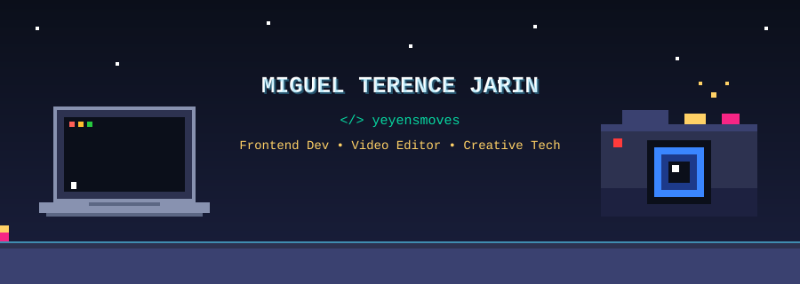

<!-- README.md -->

<!-- ============ HEADER ============ -->
<div align="center">




<a href="https://github.com/yeyensmoves">
  
</a>

<br/>

📍 Philippines 🇵🇭


[](https://github.com/yeyensmoves)
[](https://www.facebook.com/miguelterence.jarin)
[](https://www.instagram.com/yeeyeeenz_/)

</div>


<!-- ============ ABOUT ============ -->
## 💫 About Me

```js
const miguel = {
  name: "Miguel Terence Jarin",
  handle: "yeyensmoves",
  location: "Philippines 🇵🇭",
  roles: ["Frontend Developer", "Video Editor", "Creative Technologist"],
  currentlyLearning: ["Full-stack development", "UI/UX design", "Better storytelling"],
  hobbies: ["Photography 📸", "Videography 🎥", "Video editing 🎬", "Building websites 💻"],
  funFact: "I like turning code and camera footage into experiences people remember."
};
```

- 💻 Interested in **frontend & full-stack** web development
- 🎨 Passionate about **UI/UX design** and creative visuals
- 🎬 Experienced in **photography, videography & video editing**
- 🌱 Constantly learning and levelling up my dev skills
- 🚀 Building **meaningful and practical** digital projects


<!-- ============ HOBBIES ============ -->
## 🎮 What I Love Doing

<div align="center">
  
</div>


<!-- ============ TECH STACK ============ -->
## 🛠️ Tech Stack

**Languages**

<p align="left">
  
</p>

**Frameworks & Technologies**

<p align="left">
  
</p>

**Databases & Cloud**

<p align="left">
  
</p>

**Design & Creative Tools**

<p align="left">
  
</p>

**Development Environment**

<p align="left">
  
</p>


<!-- ============ ANALYTICS ============ -->
## 📊 GitHub Analytics

<div align="center">


<br/>


</div>


<!-- ============ CONNECT ============ -->
## 🤝 Let's Connect!

<div align="center">

I'm always open to learning, collaborating, and building creative projects. 📸💻🎬

<a href="https://github.com/yeyensmoves">
  
</a>
<a href="https://www.facebook.com/miguelterence.jarin">
  
</a>
<a href="https://www.instagram.com/yeeyeeenz_/">
  
</a>

<br/><br/>

**Thanks for visiting my profile!** ⭐


</div>
